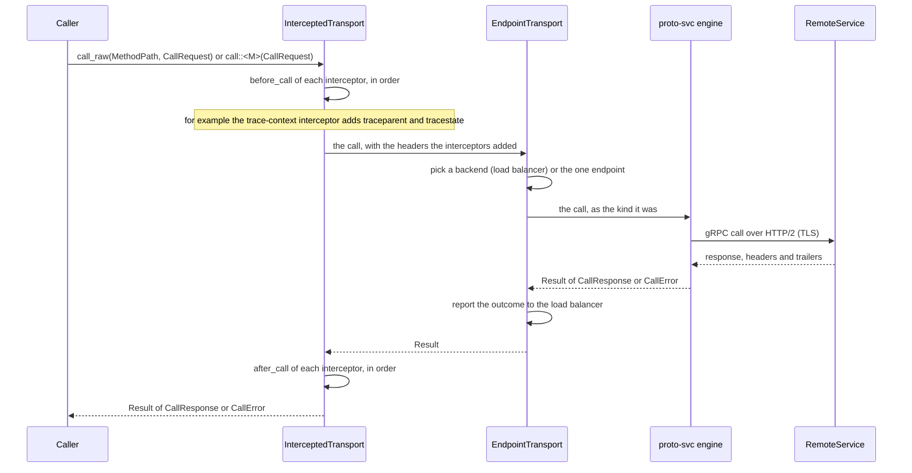
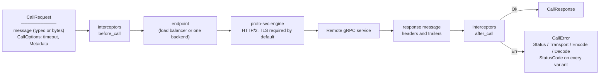

# Architecture: edge-transport-grpc-egress

## Sequence

> A caller makes a call on the client the builder returned: a `proto-pattern` `Transport` (a call over a `Method`) and
> `RawTransport` (a call to a path, with bytes). The interceptor chain runs before the call and again after a response
> with a message; it is empty unless interceptors were attached. The engine (`proto-svc`) owns the wire.

The types of the client are private to the crate; the builder's `build()` returns them as
`impl Transport + RawTransport`. Retry, a circuit breaker, a cancellation token and a security context wrap that
value without knowing its type ([ADR-009](adr/ADR-009-the-egress-api-on-the-contract.md)).

## Data Flow

> A call is either typed (the caller's `Payload` encodes and decodes the message) or raw (bytes in, bytes out). The
> transport serialises nothing of its own.

