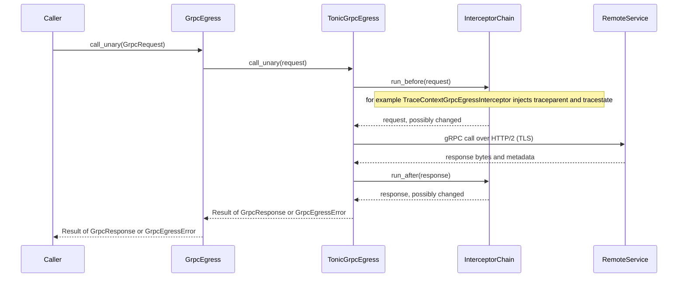
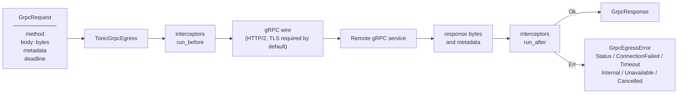

# Architecture: edge-transport-grpc-egress

## Sequence

> A caller uses `GrpcEgress` to call a downstream gRPC service. The interceptor chain runs before the wire call and again after it. The chain is empty unless interceptors were attached.

`TonicGrpcEgress` is a private type of the crate; callers hold the client as `Arc<dyn GrpcEgress>`.

## Data Flow

> The request is bytes: the caller encodes the message and decodes the response (the optional `prost` feature adds a typed layer). Nothing is serialised by the transport.

